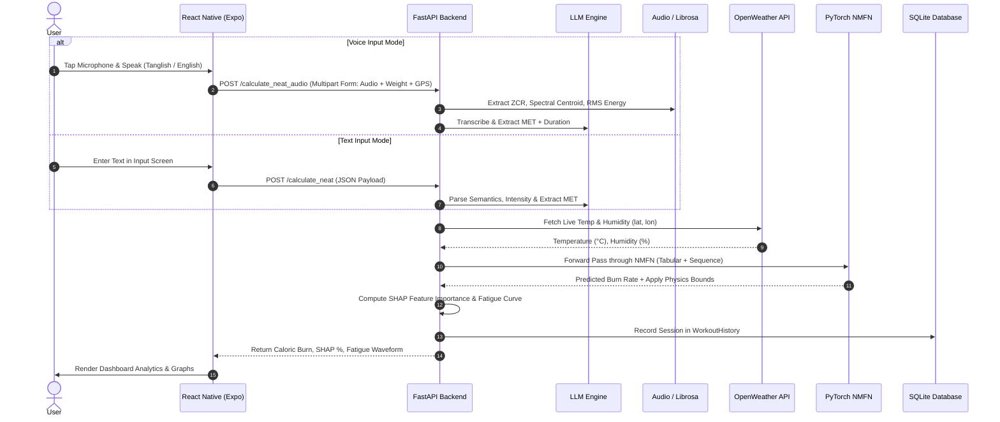

# Sensorless Estimation of Non-Exercise Activity Thermogenesis (NEAT) via Multilingual NLP and Physics-Informed Hybrid Modeling

[](https://www.python.org/)
[](https://fastapi.tiangolo.com/)
[](https://reactnative.dev/)
[](https://pytorch.org/)
[](https://github.com/shap/shap)
[](LICENSE)

An end-to-end ambient intelligence and biomedical computing platform designed to estimate **Non-Exercise Activity Thermogenesis (NEAT)** without wearable physiological sensors. The system combines cross-lingual natural language understanding (English, Tamil, and colloquial Tanglish), acoustic biomarker extraction, live meteorological telemetry, and a **Physics-Informed Neuro-Metabolic Fusion Network (NMFN)** constrained by human biomechanical energy laws.

---

## Table of Contents

- [Overview](#overview)
- [Problem Statement](#problem-statement)
- [Project Objectives](#project-objectives)
- [Proposed Solution](#proposed-solution)
- [System Architecture](#system-architecture)
- [Core Technologies](#core-technologies)
  - [Frontend Ecosystem](#frontend-ecosystem)
  - [Backend & Machine Learning Ecosystem](#backend--machine-learning-ecosystem)
- [Multilingual NLP & Speech Intelligence](#multilingual-nlp--speech-intelligence)
- [Neuro-Metabolic Fusion Network (NMFN)](#neuro-metabolic-fusion-network-nmfn)
- [Physics-Informed Modeling Approach](#physics-informed-modeling-approach)
- [System Workflows](#system-workflows)
  - [Text & Audio Capture Workflow](#text--audio-capture-workflow)
  - [NEAT Estimation & Analytics Pipeline](#neat-estimation--analytics-pipeline)
- [Project Directory Structure](#project-directory-structure)
- [Installation & Setup](#installation--setup)
  - [Prerequisites](#prerequisites)
  - [Backend Setup](#backend-setup)
  - [Frontend Setup](#frontend-frontend-setup)
- [API Reference](#api-reference)
- [Model Weights & Pretrained Checkpoints](#model-weights--pretrained-checkpoints)
- [Screenshots & Visuals](#screenshots--visuals)
- [Future Enhancements](#future-enhancements)
- [Author & Acknowledgments](#author--acknowledgments)

---

## Overview

Non-Exercise Activity Thermogenesis (NEAT) represents the energy expended for everything we do that is not sleeping, eating, or sports-like exercise — ranging from walking to work, stair climbing, pacing during phone calls, typing, fidgeting, and domestic chores. While NEAT accounts for the most variable and adaptable component of total daily energy expenditure (TDEE), its continuous tracking has historically necessitated intrusive wearable sensors (e.g., accelerometers, heart-rate monitors, continuous metabolic carts).

This repository presents a **sensorless, multilingual, physics-grounded alternative**: users report daily routine events via spontaneous voice logs or natural text in multiple regional dialects. The platform transcribes speech, extracts respiratory and vocal biomarkers, deduces exact physical intensity through LLM-driven semantic Compendium of Physical Activities parsing, captures live ambient environmental variables (temperature and humidity), and infers total caloric expenditure and circadian fatigue curves through a custom multi-branch neural network.

---

## Problem Statement

1. **Intrusiveness & Wearable Fatigue:** Consumer smartbands and smartwatches require continuous skin contact, frequent charging, and user adherence, resulting in high attrition rates in longitudinal health studies.
2. **Context-Blind Caloric Estimation:** Inertial Measurement Units (IMUs) measure motion vectors but miss ambient environmental strain (e.g., heat index, humidity) and physiological cognitive state (vocal fatigue, breathlessness).
3. **Linguistic & Regional Gaps:** Existing health apps rely strictly on rigid English keyword matching or fixed drop-down menus, failing to parse code-mixed, colloquial languages such as Tanglish (Tamil written in Latin script with English mixing) or colloquial phrasing.
4. **Biomechanical Hallucination in Deep Models:** Standard unconstrained neural regressors can output unphysical metabolic rates (e.g., negative calories burned or biologically impossible burn rates exceeding human thermodynamic limits).

---

## Project Objectives

- **Eliminate Hardware Dependency:** Accurately estimate NEAT purely from ambient multimodal logs (natural language transcriptions, audio speech signals, and GPS-derived microclimate telemetry).
- **Deliver Native Multilingual Extraction:** Support conversational, code-mixed natural language logs across English, Tamil, and Tanglish without rigid pre-defined schema constraints.
- **Implement Physics-Informed Regularization:** Constrain neural network loss functions using human thermodynamic boundaries and dynamic biomechanical upper limits ($B_{\text{max}}$).
- **Provide Model Interpretability:** Deliver real-time, normalized feature attribution using SHAP (SHapley Additive exPlanations) alongside circadian fatigue crash forecasts directly to the user dashboard.

---

## Proposed Solution

```
┌────────────────────────────────────────────────────────────────────────┐
│                        USER INPUT MODALITY                             │
│     [Microphone: Audio M4A]       OR       [Natural Text: Tanglish]    │
└───────────────────┬─────────────────────────────────┬──────────────────┘
                    │                                 │
                    ▼                                 ▼
   ┌────────────────────────────────┐ ┌────────────────────────────────┐
   │    Audio Biomarker Analysis    │ │  Semantic LLM Task Extraction  │
   │  • Zero-Crossing Rate (ZCR)    │ │  • Dynamic MET Deduction       │
   │  • Spectral Centroid (Pitch)   │ │  • Activity Duration & Stacking│
   │  • RMS Energy                  │ │  • Contextual Intensity Scale  │
   └────────────────┬───────────────┘ └────────────────┬───────────────┘
                    │                                 │
                    └────────────────┬────────────────┘
                                     ▼
   ┌───────────────────────────────────────────────────────────────────┐
   │                 GPS & MICROCLIMATE TELEMETRY                      │
   │  • Reverse Geo / Coordinate Lookup                                │
   │  • Live Temperature (°C) & Relative Humidity (%)                  │
   └─────────────────────────────────┬─────────────────────────────────┘
                                     ▼
   ┌───────────────────────────────────────────────────────────────────┐
   │         NEURO-METABOLIC FUSION NETWORK (PyTorch Architecture)     │
   │                                                                   │
   │   Tabular Branch (4D)              Sequence RNN Branch (5x3D)     │
   │   [Weight, MET, Temp, Humidity]    [Acoustic Biomarker Sequence]  │
   │                │                                │                 │
   │                ▼                                ▼                 │
   │         Dense Layers (16->8)             RNN + Linear (16->8)     │
   │                │                                │                 │
   │                └──────────────┬─────────────────┘                 │
   │                               ▼                                   │
   │                     Concatenation & Fusion Gate                   │
   │                               │                                   │
   │                               ▼                                   │
   │                    Physics-Informed Regressor                     │
   │             Loss = MSE + λ * ReLU(Pred - Max_Caloric_Limit)²      │
   └───────────────────────────────┬───────────────────────────────────┘
                                   │
         ┌─────────────────────────┴─────────────────────────┐
         ▼                                                   ▼
┌─────────────────────────────────┐         ┌─────────────────────────────────┐
│     Explainable AI Engine       │         │    Circadian Fatigue Engine     │
│ • SHAP GradientExplainer        │         │ • Exponential/Gaussian Decay    │
│ • Normalized Percentage Weights │         │ • 4-Hour Crash Prediction Curve │
└────────────────┬────────────────┘         └────────────────┬────────────────┘
                 │                                           │
                 └─────────────────────────┬─────────────────┘
                                           ▼
┌─────────────────────────────────────────────────────────────────────────────┐
│                 REACT NATIVE / EXPO MOBILE CLIENT DASHBOARD                 │
│  • Total Caloric Burn (kcal)           • Dynamic SHAP Horizontal Bar Chart  │
│  • Circadian Fatigue Waveform          • Historical Workout Storage         │
└─────────────────────────────────────────────────────────────────────────────┘
```

---

## Core Technologies

### Frontend Ecosystem
- **Framework:** React Native with Expo SDK 54 (`expo`, `react-native`)
- **Language:** TypeScript with strict type configurations
- **Navigation:** React Navigation v7 (`@react-navigation/native`, `@react-navigation/bottom-tabs`, `@react-navigation/native-stack`)
- **Telemetry & Hardware APIs:**
  - `expo-av`: High-fidelity audio recording and buffer streaming (M4A / AAC)
  - `expo-location`: High-accuracy GPS tracking for ambient microclimate alignment
- **State & Local Persistence:** `@react-native-async-storage/async-storage` for biometric calibration parameters
- **Data Visualization:** `react-native-chart-kit` and `react-native-svg` for dynamic bar charts and circadian curve rendering

### Backend & Machine Learning Ecosystem
- **API Engine:** FastAPI with ASGI server Uvicorn
- **Language & Runtime:** Python 3.10+
- **Deep Learning Framework:** PyTorch (`torch`, `torchaudio`)
- **Explainability:** SHAP (`shap.GradientExplainer` & TreeSHAP modules)
- **Audio & Signal Processing:** Librosa, NumPy, SciPy
- **Multilingual Large Language Model:** Google Gemini API (`google-genai` SDK, `gemini-3.6-flash` / Gemini reasoning models) for zero-shot Tanglish parsing and dynamic MET deduction
- **Alternative NLP Pipeline:** Hugging Face Transformers (`openai/whisper-tiny` for ASR, `XLM-RoBERTa` for multilingual NER)
- **Database:** SQLAlchemy ORM with SQLite backend (`neat_tracker.db`)
- **Meteorological Integration:** OpenWeatherMap OneCall REST API integration

---

## Multilingual NLP & Speech Intelligence

The platform accommodates unstructured regional inputs through a dual-stream NLP engine:

1. **Automatic Speech Recognition (ASR):**
   - Implemented via `openai/whisper-tiny` in `backend/services/audio_service.py`.
   - Audio is resampled to 16 kHz mono. Whisper's encoder-decoder transformer automatically detects language tokens and transcribes speech into text without requiring explicit manual language flags.
2. **Acoustic Biomarker Extraction:**
   - Raw audio waveforms are parsed through `librosa` to compute non-semantic physiological indicators:
     - **Zero-Crossing Rate (ZCR):** Correlated with acoustic spectral noisiness and speech turbulence.
     - **Spectral Centroid:** Tracks speech frequency brightness and pitch shifts under physical exertion.
     - **Root-Mean-Square Energy (RMS):** Measures amplitude and vocal volume fluctuations.
3. **Cross-Lingual Semantic Intelligence:**
   - Evaluates mixed-code inputs (e.g., *"Naan indha route-la 5km nadandhen for 30min"*, *"Aaj dopahar me 45 min brisk walk kiya tha"*).
   - Powered by Gemini multimodal APIs configured with low temperature (`temperature=0.1`) and structured Pydantic schema validation (`LLMMetricsOutput`).
   - Dynamically indexes biomechanical equivalents against the **Compendium of Physical Activities** without rigid lookup tables, allowing activity stacking (e.g., "pacing while carrying groceries").

---

## Neuro-Metabolic Fusion Network (NMFN)

The **NeuroMetabolicFusionNetwork** (`backend/ml_engine.py`) employs a multi-branch architecture to combine static biometrics with time-series signals:

```
Tabular Branch:
Input (Dim 4: Weight, MET, Temp, Humidity) 
  ──> Linear(4, 16) ──> ReLU ──> Linear(16, 8) ──────────────────────┐
                                                                       │
Sequential Branch:                                                    ├──> Concat (16) ──> Linear(16, 16) ──> ReLU ──> Linear(16, 1) [Burn Rate]
Input (Dim 3: ZCR, Centroid, RMS across T timesteps)                  │
  ──> RNN(3, Hidden=16) ──> Last Hidden State ──> Linear(16, 8) ──────┘
```

- **Tabular Branch:** Processes static user mass, deduced activity MET, ambient temperature, and ambient humidity.
- **Sequence RNN Branch:** Ingests dynamic acoustic biomarker representations.
- **Fusion Gate:** Concatenates latent representations into a dense fusion layer to predict instantaneous caloric expenditure rates ($\text{kcal/hour}$).

---

## Physics-Informed Modeling Approach

Standard machine learning models optimize purely for empirical error minimization ($L_{\text{MSE}}$), occasionally generating unphysical predictions during domain shifts or data outliers. The NMFN architecture enforces **Physics-Informed Constraints**:

1. **Physics Penalty Loss Function:**
   During training, predictions exceeding biological ceiling rates (e.g., human maximum non-exercise expenditure limits of 1500 kcal/hr) trigger quadratic penalty regularization:
   $$\mathcal{L}_{\text{total}} = \mathcal{L}_{\text{MSE}} + \lambda \cdot \mathbb{E}\left[ \max(0, \hat{y} - y_{\text{limit}})^2 \right]$$
   where $\lambda = 10.0$ heavily penalizes biomechanical boundary violations.

2. **Dynamic Biomechanical Upper Cap ($B_{\text{max}}$):**
   At inference time, the model caps output burn rates dynamically as a function of body mass:
   $$B_{\text{max}} = \text{weight}_{\text{kg}} \times 25.0 \text{ kcal/hr}$$

3. **Lower Bound Thermodynamic Sanity Check:**
   Ensures calculated expenditure cannot fall below basal physical constraints:
   $$\text{Calories}_{\text{min}} = \left( \frac{\text{MET} \times 3.5 \times \text{weight}_{\text{kg}}}{200} \right) \times \text{duration}_{\text{mins}}$$

4. **Circadian Fatigue Decay Function:**
   Calculates an exponential fatigue progression over a 4-hour window:
   $$\text{Fatigue}(t) = \text{Base} + 80 \times \left(1 - e^{-\left(0.5 + \frac{\text{Burn}}{400}\right) \cdot \frac{t}{2}}\right)$$

---

## System Workflows

### Text & Audio Capture Workflow



---

## Project Directory Structure

```
.
├── .gitignore                  # Git ignore rules for secrets, DBs, node_modules & caches
├── App.tsx                     # Main application entry with Bottom Tab Navigator
├── app.json                    # Expo project configuration
├── config.ts                   # Centralized API endpoint configuration
├── package.json                # Frontend dependencies and npm scripts
├── package-lock.json           # Exact dependency lockfile
├── tsconfig.json               # TypeScript compiler configuration
│
├── backend/                    # FastAPI and PyTorch backend
│   ├── .env.example            # Environment template for API keys
│   ├── database.py             # SQLAlchemy models (User, WorkoutHistory) and SQLite setup
│   ├── fusion_model.pth        # Trained PyTorch NeuroMetabolicFusionNetwork checkpoint
│   ├── main.py                 # FastAPI application routes, middleware, and orchestrator
│   ├── ml_engine.py            # PyTorch NMFN model class, physics loss, and SHAP explainer
│   ├── requirements.txt        # Backend Python dependencies
│   ├── models/
│   │   └── fusion_model.py     # Hybrid XGBoost + LSTM legacy/alternative pipeline
│   └── services/
│       ├── audio_service.py    # Whisper ASR and Librosa acoustic feature extraction
│       ├── explainability_service.py # TreeSHAP explainability & circadian curve utilities
│       ├── nlp_service.py      # HuggingFace NER token classification service
│       └── weather_service.py  # OpenWeatherMap meteorological HTTP client
│
└── screens/                    # React Native application screens
    ├── DashboardScreen.tsx     # Caloric output, SHAP bar chart, and circadian curve
    ├── DataInputScreen.tsx     # Voice recording (expo-av) and text submission UI
    ├── HistoryScreen.tsx       # Past workout and session logs from SQLite
    └── ProfileScreen.tsx       # Biomechanical profile calibration (weight, height, age)
```

---

## Installation & Setup

### Prerequisites
- **Node.js:** v18.0.0 or later (v20+ recommended)
- **Python:** v3.10 to v3.13
- **Expo Go App:** Installed on your physical Android or iOS device (available via Google Play or App Store)
- **Git:** Version 2.30+

---

### Backend Setup

1. **Navigate to the backend directory:**
   ```bash
   cd backend
   ```

2. **Create and activate a Python virtual environment:**
   ```bash
   # On Windows (PowerShell)
   python -m venv venv
   .\venv\Scripts\Activate.ps1

   # On macOS / Linux
   python3 -m venv venv
   source venv/bin/activate
   ```

3. **Install dependencies:**
   ```bash
   pip install -r requirements.txt
   ```

4. **Configure environment variables:**
   Copy `.env.example` to `.env`:
   ```bash
   cp .env.example .env
   ```
   Open `backend/.env` and insert your API credentials:
   ```env
   GEMINI_API_KEY=your_gemini_api_key_here
   OPENWEATHER_API_KEY=your_openweathermap_api_key_here
   ```

5. **Verify or re-train model weights (optional):**
   The repository includes a trained checkpoint `fusion_model.pth`. To retrain the network with physics-informed loss from scratch:
   ```bash
   python ml_engine.py
   ```

6. **Start the FastAPI backend server:**
   ```bash
   uvicorn main:app --host 0.0.0.0 --port 8000 --reload
   ```
   The backend will be live at `http://localhost:8000`. The interactive Swagger API docs will be accessible at `http://localhost:8000/docs`.

---

### Frontend Setup

1. **Navigate to the root directory:**
   ```bash
   cd ..
   ```

2. **Install JavaScript dependencies:**
   ```bash
   npm install
   ```

3. **Configure API connection:**
   Open `config.ts` and set `API_BASE_URL` to your machine's local network IP address (do not use `localhost` if testing on a physical mobile device):
   ```typescript
   export const API_BASE_URL = "http://<YOUR_LOCAL_IP>:8000";
   ```

4. **Launch the Expo development server:**
   ```bash
   npx expo start
   ```

5. **Run on device:**
   - Scan the QR code displayed in the terminal using the **Expo Go** mobile application.
   - Ensure your mobile device and development workstation are connected to the same local Wi-Fi network.

---

## API Reference

### 1. `POST /calculate_neat`
Estimates NEAT from manual text transcripts, biometric metrics, and ambient coordinates.

- **Request Body (`application/json`):**
  ```json
  {
    "user_id": "user_01",
    "weight_kg": 72.0,
    "met_value": 3.0,
    "temperature": 28.5,
    "humidity": 65.0,
    "duration_mins": 45.0,
    "intensity": "Normal",
    "transcript": "Walked 3 km around the neighborhood park",
    "latitude": 12.9246,
    "longitude": 79.3331
  }
  ```

- **Response (`200 OK`):**
  ```json
  {
    "status": "success",
    "data": {
      "duration_mins": 45,
      "base_met": 3.5,
      "detected_activity": "walking in park",
      "calories_burned": 157.5,
      "dynamic_met_used": 3.5,
      "temperature": 28.5,
      "humidity": 65.0,
      "shap_graph_data": {
        "labels": ["Weight", "MET", "Temp", "Humid"],
        "datasets": [{ "data": [38, 32, 18, 12] }]
      },
      "fatigue_curve": [20, 42, 68, 88, 97]
    }
  }
  ```

---

### 2. `POST /calculate_neat_audio`
Accepts a raw recorded audio file (`.m4a` / `.wav`), extracts acoustic features, deduces the activity via NLP, fetches weather telemetry, and runs inference.

- **Content-Type:** `multipart/form-data`
- **Parameters:**
  - `file`: Binary audio stream (`recording.m4a`)
  - `weight`: User weight in kg (string/float)
  - `intensity`: "Low" | "Normal" | "High"
  - `latitude`: Float (Optional)
  - `longitude`: Float (Optional)
  - `user_id`: String (Optional, defaults to `"guest"`)

---

### 3. `POST /users`
Registers or updates a user's biometric baseline.

- **Request Body:**
  ```json
  {
    "user_id": "user_01",
    "height": 178.0,
    "weight": 72.0,
    "age": 22,
    "gender": "Male"
  }
  ```

---

### 4. `GET /history/{user_id}`
Retrieves chronologically sorted historical activity sessions for the specified user.

---

## Model Weights & Pretrained Checkpoints

- Checkpoint file: `backend/fusion_model.pth` (~9.3 KB)
- The checkpoint contains the state dictionary of the 4-dimensional tabular and 3-dimensional recurrent network trained with physics-regularized caloric bounds.
- It is tracked directly within the repository, allowing developers to clone and run inference immediately without external weight hosting dependencies.

---

## Screenshots & Visuals

| Tracker Input Screen | Predictive Analytics Dashboard | Biomechanical Profile Calibration | Historical Session Timeline |
|:---:|:---:|:---:|:---:|
| | |  |
|  |
| 
|

*(Screenshots can be updated with captured application frames upon deployment)*

---

## Future Enhancements

- **Quantized Edge Deployment:** Convert the PyTorch NMFN model into ONNX / TensorFlow Lite for on-device inference directly inside React Native without requiring network calls.
- **Multilingual Whisper Base Tuning:** Fine-tune Whisper models on domain-specific Dravidian dialectal datasets for phonetic code-switching robustness.
- **Expanded Acoustic Invariants:** Incorporate jitter, shimmer, and formant tracking to detect subtle respiratory stress variations during ambulatory activities.
- **Wearable Cross-Validation:** Benchmark sensorless estimates against ground-truth research-grade metabolic carts (e.g., Cosmed K5) and dual-energy X-ray absorptiometry (DEXA) baselines.

---

## Author & Acknowledgments

- **Author:** Sharun Kumar D
- **GitHub:** [@SharunKumarD](https://github.com/SharunKumarD)
- **Institution:** Vellore Institute of Technology (VIT)
